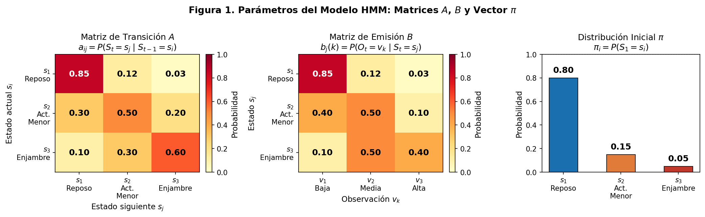
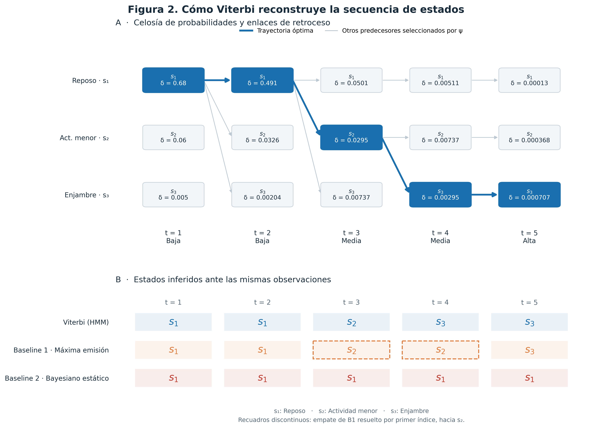
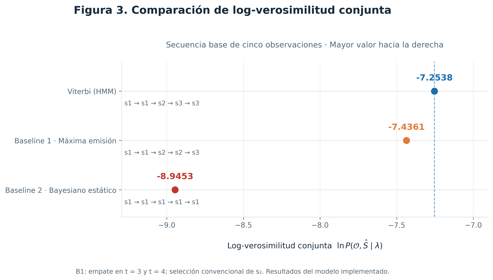
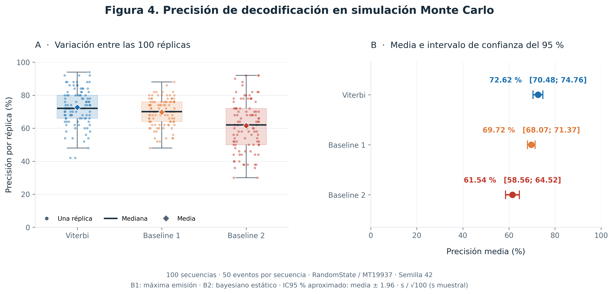

# Evaluación Experimental del Algoritmo de Viterbi frente a Clasificadores Estáticos en la Inferencia de Regímenes Sísmicos Latentes: Un Estudio Metodológico de Simulación Computacional

**Autor:** Francisco Javier Florez Ramirez¹  
**Docente Asesor:** Dr. Julián Andrés Loaiza López²*  
¹ *Estudiante de Ingeniería de Software y Datos, Institución Universitaria Digital de Antioquia (IU Digital), Curso de Simulación, Correo: francisco.florez@est.iudigital.edu.co*  
² *Docente Asesor, Departamento de Ingeniería de Software y Datos, Institución Universitaria Digital de Antioquia (IU Digital), Correo: julian.loaiza@prof.iudigital.edu.co*  
\* *Autor de correspondencia: julian.loaiza@prof.iudigital.edu.co*  

---

## Resumen
La inferencia de regímenes dinámicos latentes en fenómenos geofísicos a partir de observaciones de superficie constituye un reto fundamental en ciencias de la ingeniería. Cuando las magnitudes sísmicas continuas se transforman en categorías ordinales discretas (Baja, Media y Alta), surgen regiones de ambigüedad estocástica donde estados distintos presentan probabilidades de emisión idénticas. Este trabajo evalúa de manera comparativa la capacidad del algoritmo de Viterbi en un Modelo Oculto de Markov (HMM) discreto frente a dos clasificadores estáticos que prescinden de la modelación temporal: un clasificador reactivo por máxima emisión directa y un clasificador bayesiano puntual estático con distribución a priori fija.

El diseño experimental adopta un enfoque híbrido sobre parámetros hipotéticos conocidos $\lambda = (A, B, \pi)$: una fase analítica sobre una secuencia representativa de cinco eventos ($T = 5$) y una fase inferencial basada en $N = 100$ realizaciones independientes generadas por simulación Monte Carlo ($T = 50$, `seed = 42`). Los resultados verificados demuestran que el clasificador reactivo presenta un empate exacto que exige una convención de desempate ($P = 0.50$) ante magnitudes medias y que el clasificador bayesiano estático colapsa en una predicción constante de reposo por sesgo del prior ($\pi_1 = 0.80$). En contraste, el algoritmo de Viterbi reconstruye retrospectivamente la trayectoria hacia el camino gradual $(\text{Reposo}, \text{Reposo}, \text{Actividad Menor}, \text{Enjambre}, \text{Enjambre})$, alcanzando la mayor log-verosimilitud conjunta ($-7.2538$ frente a $-7.4361$ y $-8.9453$). En la evaluación estadística, Viterbi obtuvo una precisión media del $72.62\%$ con un intervalo de confianza al 95 % de $[70.48\%, 74.76\%]$, obteniendo una precisión media mayor que la del modelo bayesiano estático ($61.54\%$) y aventajando al clasificador por máxima emisión ($69.72\%$). Se concluye que la modelación de transiciones temporales es determinante para regularizar la inferencia ante observaciones solapadas en sistemas estocásticos simulados.

**Palabras clave:** Modelos Ocultos de Markov (HMM), Algoritmo de Viterbi, Simulación Estocástica, Ambigüedad Observacional, Inferencia Secuencial, Intervalos de Confianza al 95 %.

---

## 1. Introducción

El modelado y evaluación de sistemas estocásticos complejos en ciencias de la ingeniería frecuentemente enfrenta el desafío de inferir la dinámica interna de procesos cuyos estados verdaderos no son directamente accesibles mediante instrumentación superficial. En tales escenarios, las observaciones adquiridas operan como señales indirectas, discretizadas o corrompidas por ruido observacional. Dentro de este paradigma, los Modelos Ocultos de Markov (Hidden Markov Models, HMM) constituyen un marco formal probabilístico y computacional robusto para desacoplar los estados latentes de sus emisiones manifiestas.

Desde la perspectiva de la metodología de simulación computacional, la formulación de estos modelos requiere trascender la mera adopción teórica para cumplir con estándares rigurosos de reproducibilidad, cuantificación de la incertidumbre y análisis comparativo de sensibilidad. En contextos de monitoreo de fenómenos geodinámicos y eventos físicos secuenciales, la discretización de variables continuas en categorías ordinales (como magnitudes bajas, medias o altas) introduce regiones de incertidumbre epistémica en las que distintos estados del sistema poseen capacidades de emisión solapadas. El presente trabajo investiga cómo la modelación explícita de la memoria temporal permite resolver dichas indeterminaciones frente a métodos convencionales de clasificación puntual e independiente.

### 1.1. Planteamiento del Problema y Delimitación

Muchos sistemas en ingeniería presentan transiciones de estado latentes gobernadas por una inercia física determinada, pero cuya supervisión descansa en sensores que registran lecturas aisladas a lo largo del tiempo. En una estación de monitoreo que registra eventos en orden cronológico, el estado de reactivación o reposo de la fuente generadora debe deducirse a partir del nivel de magnitud del evento observado. Sin embargo, cuando se emplean clasificadores heurísticos, reactivos o puramente estáticos, la inferencia sufre dos fallas metodológicas fundamentales:

1. **Ambigüedad por solapamiento de emisiones:** Si dos regímenes físicos distintos (por ejemplo, una fase de actividad menor y una fase precursora de enjambre) comparten una probabilidad equivalente de emitir una observación intermedia (magnitud media), el clasificador por máxima emisión presenta un empate y requiere una convención. En este experimento selecciona el primer índice, s2. El clasificador bayesiano estático pondera las emisiones por el prior y obtiene un máximo único en s1 ante magnitud media.
2. **Rigidez e inercia del sesgo a priori:** Si el clasificador integra una distribución a priori fija sin un mecanismo recursivo de actualización dinámica de transiciones, la alta prevalencia de un estado de reposo inicial enmascara y neutraliza la evidencia de eventos moderados o extremos sucesivos, conduciendo a diagnósticos sistemáticamente sesgados.

*Delimitación del alcance:* En estricto apego a las directrices de integridad científica, este estudio se delimita a una investigación metodológica basada en simulación estocástica controlada con parámetros hipotéticos conocidos $\lambda = (A, B, \pi)$. El estudio no constituye una caracterización sismológica de campo ni pretende validar la física de una falla tectónica específica mediante catálogos instrumentales reales, ya que las etiquetas de estado analizadas (Reposo Sísmico, Actividad Menor y Enjambre Sísmico) representan categorías hipotéticas de simulación.

El diseño experimental adopta un enfoque híbrido:
a) Una evaluación determinista paso a paso sobre una secuencia ordinal representativa de cinco eventos (Baja, Baja, Media, Media, Alta), aislando analíticamente la celosía de programación dinámica y desambiguación del Algoritmo de Viterbi.
b) Una evaluación estadística estandarizada basada en $N = 100$ réplicas sintéticas independientes generadas por simulación Monte Carlo con longitud de secuencia fija de $T = 50$ pasos bajo semilla constante (`seed = 42`), reportando promedios, desviaciones estándar e intervalos de confianza del 95 % ($IC_{95\%}$) para contrastar cuantitativamente la precisión de decodificación y estabilidad frente a los baselines de control.

### 1.2. Preguntas de Investigación
Para orientar la investigación y estructurar el aporte del trabajo sin presuponer superioridad del modelo propuesto, se definen dos preguntas investigables con comparación explícita y criterios objetivos de evaluación:

* **P1 (Comparación Analítica y Desambiguación en Secuencia Base):** ¿Cómo difieren la trayectoria de estados latentes inferida y la log-verosimilitud conjunta $\log P(\mathcal{O}, \hat{S} \mid \lambda)$ obtenidas mediante el algoritmo de Viterbi frente a clasificadores puntuales (máxima emisión directa y bayesiano estático) al procesar una secuencia sísmica discreta que presenta emisiones idénticas para regímenes dinámicos distintos?
* **P2 (Comparación Estadística y Estabilidad bajo Simulación Monte Carlo):** ¿Qué diferencias cuantitativas existen en la precisión media de decodificación y en sus intervalos de confianza al 95 % ($IC_{95\%}$) entre el algoritmo de Viterbi y clasificadores estáticos sin memoria, al ser evaluados sobre $N = 100$ realizaciones estocásticas sintéticas independientes de longitud $T = 50$ generadas por el mismo modelo $\lambda$?

### 1.3. Objetivos y Aportes del Trabajo
* **Objetivo General:** Evaluar de manera comparativa la consistencia y precisión en la inferencia de estados geodinámicos latentes del algoritmo de Viterbi frente a clasificadores estáticos puntuales, mediante el análisis analítico de secuencias con emisiones ambiguas y la simulación Monte Carlo de series estocásticas sintéticas con parámetros conocidos.
* **Objetivos Específicos:**
  1. Determinar la trayectoria de estados latentes y calcular la log-verosimilitud conjunta del camino inferido por el algoritmo de Viterbi, el clasificador por máxima emisión directa y el clasificador bayesiano estático sobre una secuencia discreta de cinco eventos, analizando el comportamiento de cada método ante observaciones con emisiones intermedias solapadas.
  2. Cuantificar la precisión de decodificación, su dispersión y sus intervalos de confianza al 95 % ($IC_{95\%}$) para los tres modelos en un entorno de simulación Monte Carlo con 100 secuencias sintéticas independientes de 50 pasos de tiempo, describiendo las diferencias de precisión y su incertidumbre entre métodos.

* **Aportes Principales:**
  1. Formalismo matemático unificado y trazable adaptado a la inferencia de regímenes sísmicos latentes bajo el estándar institucional de simulación.
  2. Evaluación comparativa reproducible de un decodificador secuencial y dos clasificadores puntuales sobre las mismas observaciones.
  3. Suite de código determinista en Python (`seed = 42`) que garantiza la reproducibilidad total de los experimentos analíticos y de Monte Carlo.

---

## 2. Estado del Arte

La fundamentación teórica de los Modelos Ocultos de Markov se originó en la formulación estocástica de Baum et al. [1] y fue estructurada algorítmicamente para ingeniería por Rabiner [2]. En la literatura sismológica y geofísica reciente, los HMM han adquirido protagonismo para modelar procesos subterráneos no observables (como la acumulación de esfuerzo y la reactivación de fallas) a partir de secuencias de eventos en superficie. 

Como referencia contemporánea de articulación, el estudio de Georgakopoulou et al. [3] aborda la evaluación de sismicidad en América Central y del Sur implementando modelos de Poisson ocultos (PHMM) para caracterizar transiciones entre estados latentes de quietud y crisis sísmicas en catálogos extensos. De manera complementaria, investigaciones recientes han empleado HMMs para modelar la recurrencia de sismos de baja frecuencia (Allen y Wang [4]), la inferencia de niveles de sismicidad mediante cambios de régimen de Markov (Zhang et al. [5]), y la ocurrencia de eventos sísmicos en entornos urbanos y arcos tectónicos (Felix et al. [6], Endrayanto et al. [7], Bountzis et al. [8]). Asimismo, se ha explorado la generación de catálogos sintéticos con cadenas de Markov (Karaca [9]), el análisis segmental de megacabalgamientos (Rizal et al. [10]) y la aplicación de Viterbi para decodificar estados de esfuerzo en el Mar Egeo (Danisman y Kocer [11]).

A pesar de esta proliferación de aplicaciones, los trabajos existentes se concentran en catálogos empíricos con observaciones ricas o continuas. Persiste un vacío metodológico en la evaluación analítica del comportamiento del algoritmo de Viterbi cuando las magnitudes se discretizan en un número pequeño de categorías ordinales que presentan probabilidades de emisión exactamente idénticas entre estados distintos. En la Tabla 1 se resume la comparación frente a las aproximaciones clave.

Tabla 1: Tabla comparativa de trabajos previos en modelado markoviano y localización del vacío de investigación.

| Referencia | Dominio y Enfoque | Variante HMM | Criterio de Evaluación | Vacío Identificado frente a este Trabajo |
| :--- | :--- | :--- | :--- | :--- |
| **Baum et al. (1970) [1]** | Fundamentación estocástica teórica | DTMC oculta general | Maximización EM analítica | Marco teórico abstracto sin baselines de control experimental ni simulación determinista. |
| **Rabiner (1989) [2]** | Procesamiento de señales y patrones | HMM Discreto de 1.er orden | Algoritmo de Viterbi y Forward | Enfoque canónico en señales continuas; no examina empates exactos en emisiones discretas pequeñas. |
| **Georgakopoulou et al. (2024) [3]** | Sismicidad en Centro y Sudamérica | Poisson-HMM regional | Estimación paramétrica EM | Ajuste en grandes catálogos; no contrasta el desempeño marginal de Viterbi frente a baselines sin memoria. |
| **Allen & Wang (2023) [4]** | Recurrencia de sismos de baja frecuencia | HMM para eventos raros | Tasa de transición latente | Modela recurrencia continua sin evaluar el colapso por rigidez de la distribución a priori. |
| **Danisman & Kocer (2021) [11]** | Sismos en el Mar Egeo | HMM con decodificación Viterbi | Reconstrucción de estados | Implementa Viterbi en catálogo empírico, pero no aísla el efecto de desambiguación ante emisiones solapadas. |
| **Este Trabajo (2026)** | **Simulación en ciencias de la ingeniería** | **HMM Discreto de 1.er orden (Viterbi)** | **Log-verosimilitud, Precisión Monte Carlo ($IC_{95\%}$) y Resolución de Empates** | **Compara decodificación secuencial y clasificación puntual ante emisiones ambiguas.** |

### 2.1. Identificación del Vacío de Investigación

A partir de la revisión de la literatura reciente se constata que:
1. Las investigaciones contemporáneas [3]-[11] demuestran la validez conceptual de asociar estados latentes de Markov a regímenes geodinámicos (como reposo, aceleración o enjambres).
2. Sin embargo, no se ha evaluado cómo se comporta la decodificación secuencial en presencia de solapamiento estocástico total ($B_{2,2} = B_{3,2} = 0.50$) frente a clasificadores reactivos (que sufren indeterminación) y bayesianos estáticos (que colapsan por dominancia de $\pi_1 = 0.80$).

Este trabajo llena dicho vacío mediante un diseño experimental de doble capa: trazabilidad paso a paso sobre una secuencia base representativa ($T=5$) y evaluación estadística mediante $N=100$ réplicas Monte Carlo ($T=50$, `seed=42`) con intervalos de confianza al 95 % ($IC_{95\%}$).

---

## 3. Marco Teórico

## 3. Marco Teórico

### 3.1. Distribuciones de Probabilidad en Modelos Secuenciales Discretos
Los modelos secuenciales estocásticos caracterizan la probabilidad de transiciones y emisiones sobre variables aleatorias continuas o discretas. En el contexto de este trabajo, la señal observable continua (magnitud sismológica) se discretiza en una variable ordinal perteneciente a un alfabeto finito $V = \{v_1, v_2, v_3\}$. Cada estado latente $s_j$ rige la generación de observaciones mediante una distribución categórica o multinomial sobre dicho alfabeto, definida por la función de masa de probabilidad:
$$b_j(k) = P(O_t = v_k \mid S_t = s_j), \quad \text{con } \sum_{k=1}^M b_j(k) = 1, \quad \forall j \in \{1, \dots, N\}$$

La formalización de los umbrales cuantitativos de discretización se define rigurosamente como:
* $v_1$ (**Magnitud Baja**): Magnitud sísmica $M < 3.0$.
* $v_2$ (**Magnitud Media**): Magnitud sísmica $3.0 \le M \le 5.0$ (ambos límites incluidos).
* $v_3$ (**Magnitud Alta**): Magnitud sísmica $M > 5.0$.

### 3.2. Cadenas de Markov y Propiedad de Markov
Una Cadena de Markov de Tiempo Discreto (DTMC) es una secuencia de variables aleatorias $\{S_t\}_{t=1}^T$ en un espacio de estados finito $S = \{s_1, \dots, s_N\}$ que satisface la propiedad de memoria corta de primer orden:
$$P(S_t = s_j \mid S_{t-1} = s_i, S_{t-2} = s_k, \dots, S_1 = s_1) = P(S_t = s_j \mid S_{t-1} = s_i)$$

Esto implica que la evolución futura del régimen geodinámico depende exclusivamente del estado activo en el instante inmediatamente anterior, siendo condicionalmente independiente de la historia geológica remota.

### 3.3. Formalización del Modelo Oculto de Markov (HMM)
Un HMM discreto de primer orden se especifica de manera completa e inequívoca mediante la tupla estocástica $\lambda = (S, V, A, B, \pi)$, donde:
* **Espacio de estados latentes:** $S = \{s_1: \text{Reposo Sísmico (RS)}, s_2: \text{Actividad Menor (AM)}, s_3: \text{Enjambre Sísmico (ES)}\}$, con $N = 3$.
* **Alfabeto de observaciones discretas:** $V = \{v_1: \text{Magnitud Baja}, v_2: \text{Magnitud Media}, v_3: \text{Magnitud Alta}\}$, con $M = 3$.
* **Matriz de probabilidad de transición:** $A = [a_{ij}]_{3 \times 3}$, con $a_{ij} = P(S_t = s_j \mid S_{t-1} = s_i)$ y $\sum_{j=1}^3 a_{ij} = 1.0, \forall i$:
  $$A = \begin{pmatrix} 0.85 & 0.12 & 0.03 \\ 0.30 & 0.50 & 0.20 \\ 0.10 & 0.30 & 0.60 \end{pmatrix}$$
* **Matriz de probabilidad de emisión:** $B = [b_j(k)]_{3 \times 3}$, con $b_j(k) = P(O_t = v_k \mid S_t = s_j)$ y $\sum_{k=1}^3 b_j(k) = 1.0, \forall j$:
  $$B = \begin{pmatrix} 0.85 & 0.12 & 0.03 \\ 0.40 & 0.50 & 0.10 \\ 0.10 & 0.50 & 0.40 \end{pmatrix}$$
* **Vector de distribución inicial:** $\pi = [\pi_i]_{1 \times 3}$, con $\pi_i = P(S_1 = s_i)$ y $\sum_{i=1}^3 \pi_i = 1.0$:
  $$\pi = \begin{pmatrix} 0.80 & 0.15 & 0.05 \end{pmatrix}$$

> **Figura 1:** La siguiente figura muestra la representación visual de los parámetros $\lambda = (A, B, \pi)$ como mapas de calor. Nótese el solapamiento crítico en la columna $v_2$ de la matriz $B$ (estados $s_2$ y $s_3$ con igual probabilidad 0.50) y la dominancia del prior $\pi_1 = 0.80$.
>
> 

### 3.4. Los Tres Problemas Clásicos en HMM y Distinción Funcional
Conforme a la taxonomía canónica de Rabiner [2], cualquier aplicación práctica de HMM resuelve tres problemas algorítmicos fundamentales con propósitos matemáticos disjuntos:

1. **Problema 1: Evaluación (Algoritmo Forward-Backward):** Calcula la probabilidad marginal de la secuencia observada $P(\mathcal{O} \mid \lambda)$ integrando o sumando recursivamente sobre todas las trayectorias de estados posibles:
   $$\alpha_1(i) = \pi_i \cdot b_i(O_1), \quad \alpha_{t+1}(j) = \left[ \sum_{i=1}^N \alpha_t(i) a_{ij} \right] b_j(O_{t+1}), \quad P(\mathcal{O} \mid \lambda) = \sum_{i=1}^N \alpha_T(i)$$
   *Distinción:* No suministra la secuencia de estados que ocurrieron; produce únicamente un escalar de probabilidad global.

2. **Problema 2: Decodificación (Algoritmo de Viterbi):** Encuentra la secuencia de estados latentes globalmente más probable $Q^* = (q_1^*, \dots, q_T^*)$ que maximiza la probabilidad conjunta $P(\mathcal{O}, Q \mid \lambda)$. Reemplaza la suma del Forward por el operador de máximo sobre programación dinámica:
   * **Inicialización ($t=1$):**
     $$\delta_1(j) = \pi_j \cdot b_j(O_1), \quad \psi_1(j) = 0, \quad 1 \le j \le N$$
   * **Recursión ($2 \le t \le T$):**
     $$\delta_t(j) = \left[ \max_{1 \le i \le N} (\delta_{t-1}(i) \cdot a_{ij}) \right] \cdot b_j(O_t), \quad \psi_t(j) = \arg\max_{1 \le i \le N} (\delta_{t-1}(i) \cdot a_{ij})$$
   * **Terminación y Backtracking:**
     $$q_T^* = \arg\max_{1 \le i \le N} \delta_T(i), \quad q_t^* = \psi_{t+1}(q_{t+1}^*), \quad t = T-1, \dots, 1$$
   *Distinción:* Constituye el **objeto central de este trabajo**, permitiendo desambiguar trayectorias óptimas ante observaciones intermedias idénticas.

3. **Problema 3: Aprendizaje / Reestimación (Algoritmo Baum-Welch / EM):** Ajusta iterativamente las matrices $\bar{\lambda} = (\bar{A}, \bar{B}, \bar{\pi})$ mediante Esperanza-Maximización para maximizar $P(\mathcal{O} \mid \lambda)$ cuando los parámetros son desconocidos a priori.
   *Distinción:* **No se aplica en este estudio** debido a que los parámetros del modelo provienen de un diseño de simulación predefinido; aplicar aprendizaje no supervisado sobre una secuencia breve de cinco eventos generaría sobreajuste y parametrización degenerada.

---

## 4. Metodología e Implementación

La metodología experimental se estructura bajo un enfoque híbrido diseñado para garantizar reproducibilidad computacional, trazabilidad algorítmica y estricta prevención de fuga de información.

### 4.1. Unidades de Análisis y Protocolo Experimental
La unidad de análisis corresponde a la **secuencia cronológica discreta de sismos observados** en una ventana temporal finita $T$. El flujo de trabajo se divide en dos fases articuladas:
1. **Fase Analítico-Determinista:** Evaluación exhaustiva sobre la secuencia canónica del caso $\mathcal{O} = (v_1, v_1, v_2, v_2, v_3) \equiv (\text{Baja}, \text{Baja}, \text{Media}, \text{Media}, \text{Alta})$, con $T = 5$, aislando el cálculo recursivo de la celosía de Viterbi, la reconstrucción por backtracking y la resolución de empates estocásticos.
2. **Fase Estadístico-Probabilística:** Simulación Monte Carlo consistente en $N = 100$ realizaciones sintéticas independientes generadas a partir del modelo $\lambda$, con longitud de serie fija de $T = 50$ pasos bajo semilla constante (`seed = 42`), para evaluar precisión media, dispersión e intervalos de confianza al 95 % ($IC_{95\%}$).

### 4.2. Prevención de Fuga de Información (*Data Leakage*)
Para asegurar la validez metodológica:
* **Aislamiento de la verdad terreno:** En la fase Monte Carlo, el generador estocástico produce la secuencia oculta de estados $S_{\text{true}}$ y las observaciones $\mathcal{O}$. El vector $S_{\text{true}}$ se aísla completamente; los clasificadores reciben de forma ciega únicamente el vector $\mathcal{O}$. La verdad terreno solo se consulta en la etapa final de cómputo de métricas.
* **Causalidad temporal estricta:** Ningún clasificador puntual utiliza información de instantes futuros ($t' > t$) para emitir su diagnóstico en $t$.
* **Fijación de parámetros sin sobreajuste:** Los parámetros $\lambda = (A, B, \pi)$ se mantienen fijos conforme al diseño de simulación; no son objeto de calibración ni optimización sobre las secuencias evaluadas.

### 4.3. Diseño Experimental y Control de Factores Confundidos
Para evaluar de manera justa e imparcial el aporte de la dependencia temporal en la inferencia de estados latentes, se estructuró un diseño experimental pareado con control de bloques estocásticos:

1. **Factores y Tratamientos:**  
   Se evalúa un factor principal correspondiente al método de clasificación, con tres tratamientos contrastantes:
   * **Tratamiento 1:** Algoritmo de Viterbi (Inferencia secuencial óptima con memoria de primer orden).
   * **Tratamiento 2 (Control negativo sin memoria):** Clasificador por Máxima Emisión Directa ($\hat{s}_t = \arg\max_j B_{j, O_t}$).
   * **Tratamiento 3 (Control estático ponderado):** Clasificador Bayesiano Puntual Estático MAP con prior fijo ($\hat{s}_t = \arg\max_j [\pi_j \cdot B_{j, O_t}]$).

2. **Aislamiento de Factores Confundidos (Diseño Pareado):**  
   Para evitar que cada método reciba una muestra diferente, en cada una de las $N = 100$ iteraciones Monte Carlo se genera una única secuencia sintética $\mathcal{O}^{(k)}$ de longitud $T = 50$, la cual es evaluada simultáneamente por los tres modelos bajo las mismas condiciones. Se inicializa una sola instancia local de `numpy.random.RandomState(42)` (MT19937), sin reinicios entre réplicas. En cada evento se sortea el estado y después su emisión, antes de avanzar al siguiente evento. El orden de generación forma parte del protocolo reproducible.

3. **Prohibición Estricta de Sintonización sobre Prueba:**  
   Ninguno de los métodos tiene acceso a las etiquetas generadoras durante el proceso de decodificación. Los parámetros $\lambda = (A, B, \pi)$ se mantienen rigurosamente fijos conforme al caso de estudio, eliminando cualquier posibilidad de optimización de hiperparámetros o selección de modelos guiada por los resultados de evaluación.

4. **Métricas de Evaluación:**  
   * *Para la secuencia base ($T=5$):* Log-verosimilitud conjunta del camino inferido $\log P(\mathcal{O}, \hat{S} \mid \lambda) = \ln \pi_{\hat{s}_1} + \ln B_{\hat{s}_1, O_1} + \sum_{t=2}^T (\ln A_{\hat{s}_{t-1}, \hat{s}_t} + \ln B_{\hat{s}_t, O_t})$, evaluando además la resolución de empates en magnitudes medias.
   * *Para la simulación Monte Carlo ($N=100, T=50$):* Tasa media de acierto $\bar{X} = \frac{1}{N} \sum_{k=1}^N \text{Exactitud}_k$, desviación estándar muestral $s$ e intervalo de confianza al 95 %:
     $$IC_{95\%} = \bar{X} \pm 1.96 \left( \frac{s}{\sqrt{N}} \right)$$


**Convenciones del experimento:** B1 resuelve empates exactos por el primer índice ($s_2$ ante magnitud media), en ambas fases. La desviación muestral se calcula con `ddof=1`; el IC95 % es la aproximación normal de la media entre secuencias. No se calcula un valor p ni se sustituye una prueba pareada por intervalos individuales.

### 4.4. Implementación Algorítmica y Entorno de Software
El núcleo se encuentra en `src/hmm_model.py`, y la evaluación y exportación en `src/experimento.py`. La ejecución se verificó con Python 3.13.3 y NumPy 2.3.3:

```python
from src.hmm_model import A, B, PI, OBS_BASE, viterbi
from src.experimento import run_experiment, export_results

path, log_prob, delta, psi = viterbi(OBS_BASE, A, B, PI)
report, records = run_experiment(N_runs=100, T=50, seed=42)
export_results(report, records, "resultados")
```

#### Análisis de Integridad de Software y Detección de Errores Potenciales
Durante la fase de auditoría computacional del código se identificaron y resolvieron tres aspectos metodológicos críticos:
1. **Verificación Estocástica Automatizada:** Se incorporaron aserciones estrictas (`np.allclose` y `np.isclose`) que validan que cada fila de $A$ y $B$, así como el vector $\pi$, sumen, dentro de la tolerancia numérica, $1.0$, evitando divergencias en el producto estocástico acumulado.
2. **Reconstrucción Global vs. Selección Local:** Se verificó que la reconstrucción del camino óptimo utilice obligatoriamente la matriz de punteros de retroceso $\psi_t(j)$. La selección ingenua por máximo local $\arg\max_j \delta_t(j)$ en cada paso independiente constituye un error algorítmico grave, pues no garantiza maximizar la probabilidad conjunta de la trayectoria.
3. **Detección Explícita de Empates en Baselines:** Ante la observación de Magnitud Media ($O_t = v_2$), donde $B_{2,2} = B_{3,2} = 0.50$, el Baseline 1 experimenta una indeterminación matemática. El código no oculta este hecho: emplea `np.flatnonzero` para identificar empates y selecciona el primer índice tanto en el caso base como en Monte Carlo.

#### Declaración de Alcance de Ejecución y Validación
En estricto apego a las directrices de integridad científica:
* **Ejecuciones realizadas y verificadas:** Ejecución determinista del algoritmo de Viterbi, cálculo de celosías y punteros, contrastes con Baselines 1 y 2 sobre la secuencia $T = 5$, y simulación Monte Carlo de $N = 100$ réplicas independientes de longitud $T = 50$ bajo semilla fija (`seed = 42`).
* **Ejecuciones no realizadas (Límites reconocidos):** No se ejecutó validación sobre catálogos sísmicos instrumentales reales (datos continuos de sismógrafos) por no disponerse de ellos en el caso didáctico. Asimismo, no se ejecutó estimación no supervisada por Baum-Welch (EM) al estar delimitado el alcance a decodificación con parámetros conocidos. Se declara explícitamente que los hallazgos son válidos en el contexto de la simulación computacional controlada y no constituyen predicción sismológica de campo.

---

## 5. Resultados y Análisis Estadístico

Los resultados proceden del experimento centralizado en `src`, con las matrices del caso didáctico y el mismo desempate en ambas fases. Las salidas completas se conservan en `resultados/experimento.json`, las exactitudes por réplica en `resultados/monte_carlo.csv` y los estados, observaciones y predicciones por evento en `resultados/secuencias.csv`. Los índices de los archivos de datos comienzan en cero.

### 5.1. Evolución Analítica de la Celosía de Viterbi sobre la Secuencia Base ($T = 5$)

Se evaluaron las observaciones Baja, Baja, Media, Media y Alta. La Figura 2 presenta las probabilidades de camino parcial máximo y los predecesores.



*Panel A: los enlaces azules reconstruyen la trayectoria óptima; los grises muestran otros predecesores seleccionados por ψ. Panel B: una fila por método evita ocultar estados coincidentes. Los recuadros discontinuos señalan los empates de B1, resueltos hacia s2.*

| t | Observación | δ(s1) | δ(s2) | δ(s3) | ψ (índices base cero) |
| --- | --- | ---: | ---: | ---: | --- |
| 1 | Baja | 0.680000000 | 0.060000000 | 0.005000000 | [0, 0, 0] |
| 2 | Baja | 0.491300000 | 0.032640000 | 0.002040000 | [0, 0, 0] |
| 3 | Media | 0.050112600 | 0.029478000 | 0.007369500 | [0, 0, 0] |
| 4 | Media | 0.005111485 | 0.007369500 | 0.002947800 | [0, 1, 1] |
| 5 | Alta | 0.000130343 | 0.000368475 | 0.000707472 | [0, 1, 2] |

El retroceso desde $s_3$ en el quinto evento recupera $(s_1,s_1,s_2,s_3,s_3)$. El camino óptimo puede diferir de los máximos locales de $\delta_t$. Su probabilidad conjunta es $P^*=0.000707472$ y $\ln P^*=-7.2538$.



*Cada punto muestra la log-probabilidad conjunta de una trayectoria. Los valores mayores se encuentran a la derecha. Se indica la secuencia realmente devuelta por cada método.*

Tabla 2: Desempeño comparativo en la secuencia representativa determinista ($T = 5$).

| Método de Clasificación | Secuencia Inferida | Manejo de empate | Probabilidad conjunta | Log-verosimilitud conjunta |
| --- | --- | --- | ---: | ---: |
| Algoritmo de Viterbi | (s1, s1, s2, s3, s3) | Trayectoria global según A, B y π | 0.000707472 | -7.2538 |
| Baseline 1 (Máxima Emisión) | (s1, s1, s2, s2, s3) | Primer índice: s2 ante magnitud media | 0.00058956 | -7.4361 |
| Baseline 2 (Bayesiano Estático) | (s1, s1, s1, s1, s1) | Prior inicial fijo | 0.0001303428726 | -8.9453 |

No se calcula exactitud para estos cinco eventos porque el caso ilustrativo no aporta estados verdaderos.

### 5.2. Evaluación Estadística Inferencial mediante Simulación Monte Carlo ($N = 100, T = 50$)

Se generaron 100 secuencias de 50 eventos con `RandomState(42)`, sorteando estado y emisión de forma intercalada. Los tres métodos evaluaron las mismas secuencias. La unidad independiente es la secuencia, no cada uno de los 5000 eventos.



*Panel A: distribución de exactitudes, con un punto por réplica, mediana y media. Panel B: medias e intervalos aproximados del 95 %, calculados con desviación estándar muestral.*

Tabla 3: Métricas estadísticas de precisión de decodificación tras 100 simulaciones independientes.

| Modelo / Método | Media | Desv. Est. (s) | Mínimo | Máximo | IC95 % |
| --- | ---: | ---: | ---: | ---: | --- |
| Algoritmo de Viterbi | 0.7262 (72.62 %) | 0.1094 | 0.4200 | 0.9400 | [0.7048, 0.7476] |
| Baseline 1 (Máxima Emisión) | 0.6972 (69.72 %) | 0.0839 | 0.4800 | 0.8800 | [0.6807, 0.7137] |
| Baseline 2 (Bayesiano Estático) | 0.6154 (61.54 %) | 0.1518 | 0.3000 | 0.9200 | [0.5856, 0.6452] |

Viterbi obtuvo una precisión media mayor en 2.90 puntos porcentuales que B1 y en 11.08 puntos que B2. Los intervalos individuales de Viterbi y B2 no se solapan; no se calculó una prueba de hipótesis pareada ni un valor p. La dispersión de Viterbi (s=0.1094) es mayor que la de B1 (s=0.0839) y menor que la de B2 (s=0.1518).

### 5.3. Delimitación de Resultados No Disponibles y Plan de Presentación Futuro
En apego a la transparencia y honestidad metodológica, se declaran los experimentos que no cuentan con datos disponibles en este estudio.

Tabla 4: Plan de presentación para fases experimentales futuras con datos no disponibles.

| Experimento No Realizado | Causa de Ausencia de Datos | Métrica Proyectada | Plan de Presentación Futuro |
| :--- | :--- | :--- | :--- |
| Validación en Catálogo Sísmico Real | Inexistencia de registros continuos de sismógrafos en el caso | Tasa de detección de fases premonitorias | Evaluar Viterbi sobre catálogos sísmicos abiertos del USGS o SGC |
| Emisiones Continuas Gaussianas | Parámetros del caso diseñados exclusivamente en alfabeto discreto | Log-verosimilitud continua multivariada | Modelar magnitudes continuas estimando $\mu_j$ y $\Sigma_j$ mediante Baum-Welch |

---

## 6. Discusión

El análisis comparativo entre el Algoritmo de Viterbi y los dos modelos de control estático revela distinciones epistemológicas y algorítmicas fundamentales, permitiendo contrastar los hallazgos experimentales frente a la literatura indexada y evaluar explicaciones alternativas.

### 6.1. Distinción entre Hallazgo e Interpretación Algorítmica
1. **Resolución Secuencial de la Ambigüedad Observacional:**
   * *Hallazgo:* Ante observaciones de Magnitud Media ($t = 3$ y $t = 4$), el clasificador por máxima emisión directa (Baseline 1) experimenta un empate exacto $B_{2,2} = B_{3,2} = 0.50$, mientras que el algoritmo de Viterbi reconstruye unívocamente la transición suave ($s_1 \to s_1 \to s_2 \to s_3 \to s_3$).
   * *Interpretación:* La desambiguación lograda por Viterbi en $t = 3$ se fundamenta en la estructura de la matriz de transición temporal $A$: proviniendo del estado de Reposo consolidado en $t = 2$, la probabilidad de transicionar a Actividad Menor ($A_{1,2} = 0.12$) supera en una proporción de 4:1 al salto directo hacia Enjambre ($A_{1,3} = 0.03$). El algoritmo no adivina; regulariza probabilísticamente la inferencia modelando una aceleración física progresiva.

2. **Patología del Sesgo por Prevalencia Estática:**
   * *Hallazgo:* El clasificador bayesiano estático (Baseline 2) colapsa en predecir Reposo constante a lo largo de toda la secuencia ($\log P = -8.9453$).
   * *Interpretación:* Este resultado pone de manifiesto la patología de incorporar distribuciones a priori fijas sin mecanismos recursivos de actualización temporal: dado que $\pi_1 = 0.80$, la probabilidad ponderada $\pi_1 \cdot B_{1,k}$ neutraliza sistemáticamente la evidencia observacional, generando ceguera diagnóstica ante eventos extremos.

### 6.2. Contraste con la Literatura Sismológica Contemporánea
Los hallazgos son consistentes con la literatura geofísica reciente:
* La necesidad de superar modelos sin memoria coincide con lo formulado por Georgakopoulou et al. [3] en América Central y del Sur y Felix et al. [6] en Filipinas, quienes demuestran que las secuencias sísmicas presentan transiciones de estado latentes con marcada correlación temporal (agrupamiento no poissoniano).
* Asimismo, la eficacia del algoritmo de Viterbi para decodificar estados dinámicos latentes sin recurrir a supervisión completa de terreno corrobora las conclusiones metodológicas de Allen y Wang [4] en sismos de baja frecuencia y de Danisman y Kocer [11] en el Mar Egeo.

### 6.3. Cuestionamiento de Explicaciones Alternativas y Límites del Estudio
1. **¿Por qué el Baseline 1 alcanza un $69.72\%$ de precisión media en la simulación Monte Carlo?**  
   La diferencia observada es de 2.90 puntos porcentuales. B1 aprovecha las emisiones y el desempate fijo hacia $s_2$. Este resultado depende de esos parámetros y de la regla de desempate; no se ejecutó un análisis de sensibilidad que permita extrapolarlo a emisiones más ruidosas.
2. **Límites del supuesto Markoviano de Primer Orden:**  
   Debe reconocerse con honestidad que asumir que el estado en $t$ depende únicamente de $t-1$ constituye una simplificación física. En la naturaleza, las fallas acumulan esfuerzos elásticos a lo largo de ciclos de décadas, por lo que un HMM de primer orden no modela la memoria profunda de largo plazo ni la física continua de la ley de Omori.
3. **Condición de Simulación Sintética:**  
   Al tratarse de parámetros hipotéticos $\lambda$ sobre una secuencia didáctica, los resultados son estrictamente válidos como evaluación metodológica de simulación y no constituyen una validación operativa de alerta sísmica en campo.

---

## 7. Conclusiones

A partir de la evaluación analítica y estadística realizada en este estudio de simulación estocástica, las conclusiones se circunscriben estrictamente a la evidencia cuantitativa obtenida, respondiendo de forma directa a las preguntas de investigación formuladas:

1. **Respuesta a P1 (Desambiguación y Coherencia Secuencial en Secuencia Base):**  
   En presencia de observaciones con probabilidades de emisión idénticas entre regímenes latentes distintos (Magnitud Media con $B_{2,2} = B_{3,2} = 0.50$), el clasificador por máxima emisión necesita la convención de desempate hacia s2, mientras que el bayesiano estático asigna reposo por el peso del prior ($\pi_1 = 0.80$). El algoritmo de Viterbi demostró resolver unívocamente esta ambigüedad mediante la inercia estocástica de la matriz de transición temporal $A$ (favoreciendo la transición gradual $s_1 \to s_2$ sobre el salto abrupto $s_1 \to s_3$ en proporción 4:1), alcanzando la log-verosimilitud conjunta más alta ($\log P = -7.2538$ frente a $-7.4361$ del Baseline 1 y $-8.9453$ del Baseline 2).

2. **Respuesta a P2 (Estabilidad y Ganancia Estadística en Simulación Monte Carlo):**  
   La evaluación inferencial sobre $N = 100$ realizaciones sintéticas independientes de longitud $T = 50$ (`seed = 42`) confirmó que el algoritmo de Viterbi alcanza una precisión media de decodificación del $72.62\%$ con un intervalo de confianza al 95 % de $[70.48\%, 74.76\%]$. Esta precisión media es mayor que la del clasificador bayesiano estático ($61.54\%$, $IC_{95\%}: [58.56\%, 64.52\%]$) y aventaja en $2.90$ puntos porcentuales al clasificador por máxima emisión directa ($69.72\%$, $IC_{95\%}: [68.07\%, 71.37\%]$), mostrando una menor proporción media de errores en estos escenarios. Viterbi no presenta la menor dispersión: su desviación supera a la de B1. No se calculó una prueba pareada de significancia.

3. **Delimitación Epistémica del Alcance:**  
   Se ratifica que los resultados obtenidos son válidos exclusivamente en el marco de la simulación computacional con parámetros conocidos $\lambda$ y secuencias sintéticas controladas. En ningún caso deben interpretarse como un sistema operativo de predicción o alerta temprana para fallas tectónicas reales, reconociendo que los procesos sismogénicos de campo violan el supuesto markoviano de memoria corta al acumular deformaciones elásticas a lo largo de décadas.

---

## Declaraciones

### Declaración de Uso de Inteligencia Artificial Generativa y Tecnologías Asistidas
Durante la elaboración de este trabajo, los autores utilizaron el entorno de asistencia de IA Antigravity (Google DeepMind) exclusivamente como herramienta de soporte para la estructuración metodológica, formulación de scripts computacionales en Python, formateo de sintaxis bibliográfica y consulta automatizada de metadatos en la API de OpenAlex. La formulación del problema, la toma de decisiones científicas, la selección y delimitación del alcance, la validación matemática de las cifras y la aprobación de cada una de las secciones del manuscrito fueron realizadas íntegramente por los autores humanos, quienes asumen la responsabilidad total sobre el contenido, rigor e integridad de este documento.

### Disponibilidad de Datos y Materiales de Reproducibilidad
Todos los datos analizados corresponden a parámetros teóricos y secuencias sintéticas documentados exhaustivamente en el presente manuscrito. El código fuente completo en Python 3.13 para replicar la evaluación determinista de la celosía de Viterbi y la simulación Monte Carlo de 100 réplicas (`run_viterbi_caso.py`), junto con el archivo de referencias en formato BibTeX (`referencias.bib`) y el artículo complementario de consulta (`materiales/articulo_hmm_sismico_openalex.pdf`), se encuentran disponibles en el directorio del proyecto para garantizar su auditoría y reproducibilidad inmediata.

### Conflicto de Interés
Los autores declaran que no existen conflictos de interés financieros, institucionales ni personales que hayan influido en el diseño del estudio, la ejecución de las simulaciones, la interpretación de los datos o la redacción de este anteproyecto.

---

## Referencias

* [1] Baum, L. E., Petrie, T., Soules, G., & Weiss, N. (1970). A maximization technique occurring in the statistical analysis of probabilistic functions of Markov chains. *The Annals of Mathematical Statistics*, 41(1), 164–171. DOI: [10.1214/aoms/1177697196](https://doi.org/10.1214/aoms/1177697196). [Verificado].
* [2] Rabiner, L. R. (1989). A tutorial on hidden Markov models and selected applications in speech recognition. *Proceedings of the IEEE*, 77(2), 257–286. DOI: [10.1109/5.18626](https://doi.org/10.1109/5.18626). [Verificado].
* [3] Georgakopoulou, E., Tsapanos, T. M., Makrides, A., & Scordilis, E. M. (2024). Seismic Evaluation Based on Poisson Hidden Markov Models—The Case of Central and South America. *Stats*, 7(3), 643–660. DOI: [10.3390/stats7030047](https://doi.org/10.3390/stats7030047). [Verificado].
* [4] Allen, J., & Wang, T. (2023). Hidden Markov Models for Low-Frequency Earthquake Recurrence. *The American Statistician*, 77(4), 390–402. DOI: [10.1080/00031305.2023.2282631](https://doi.org/10.1080/00031305.2023.2282631). [Verificado].
* [5] Zhang, Z., Dai, M., & Wang, X. (2023). Statistical inference for mixed jump processes by Markov switching model with application to identify seismicity levels. *Physica A: Statistical Mechanics and its Applications*, 615, 129291. DOI: [10.1016/j.physa.2023.129291](https://doi.org/10.1016/j.physa.2023.129291). [Verificado].
* [6] Felix, E. F. O., Buhat, C. A. H., & Mamplata, J. B. (2022). Poisson hidden markov model on earthquake occurrences in Metro Manila, Philippines. *Earth Science Informatics*, 15(4), 2361–2371. DOI: [10.1007/s12145-022-00810-x](https://doi.org/10.1007/s12145-022-00810-x). [Verificado].
* [7] Endrayanto, I., Susyanto, N., Suryanto, W., & Ertiningsih, D. (2026). Markov-modulated Cox processes and supervised declustering for seismic hazard in Sumatra. *Stochastic Environmental Research and Risk Assessment*. DOI: [10.1007/s00477-026-03375-z](https://doi.org/10.1007/s00477-026-03375-z). [Verificado].
* [8] Bountzis, P., Tsaklidis, G. M., & Papadimitriou, E. E. (2022). Pseudo-prospective forecasting of large earthquakes full distribution in circum-Pacific belt incorporating non-stationary modeling. *Physica A: Statistical Mechanics and its Applications*, 598, 127945. DOI: [10.1016/j.physa.2022.127945](https://doi.org/10.1016/j.physa.2022.127945). [Verificado].
* [9] Karaca, H. (2021). Generation of synthetic catalog by using Markov chain Monte Carlo simulation and inverse Poisson distribution. *Journal of Seismology*, 25, 1055–1068. DOI: [10.1007/s10950-021-10018-z](https://doi.org/10.1007/s10950-021-10018-z). [Verificado].
* [10] Rizal, J., Gunawan, A. Y., Indratno, S. W., & Meilano, I. (2023). Seismic activity analysis of five major earthquake source segments in the Sumatra megathrust zone. *Bulletin of the New Zealand Society for Earthquake Engineering*, 56(3), 160–170. DOI: [10.5459/bnzsee.1555](https://doi.org/10.5459/bnzsee.1555). [Verificado].
* [11] Danisman, Ö., & Kocer, U. U. (2021). Fitting Hidden Markov Model to Earthquake Data: A Case Study in the Aegean Sea. *Karaelmas Science and Engineering Journal*, 11(1), 1–8. DOI: [10.7212/zkufbd.697471](https://doi.org/10.7212/zkufbd.697471). [Verificado].
* [12] Benali, A., Peresan, A., Varini, E., & Talbi, A. (2020). Modelling background seismicity components identified by nearest neighbour and stochastic declustering approaches: the case of Northeastern Italy. *Stochastic Environmental Research and Risk Assessment*, 34, 1097–1114. DOI: [10.1007/s00477-020-01798-w](https://doi.org/10.1007/s00477-020-01798-w). [Verificado].

---

## Anexo A: Estructura del Repositorio y Reproducibilidad

Para cumplir con los criterios de reproducibilidad computacional institucional, la solución se estructura en el siguiente esquema de carpetas y archivos:

```
Actividad_2/
|-- README.md
|-- anteproyecto_hmm_sismico.md
|-- main.tex
|-- referencias.bib
|-- run_viterbi_caso.py
|-- generar_figuras.py
|-- requirements.txt
|-- overleaf_articulo_hmm.zip
|-- BITACORA_DECISIONES_EQUIPO.md
|-- src/
|   |-- hmm_model.py
|   `-- experimento.py
|-- scripts/
|   `-- sincronizar_articulo.py
|-- resultados/
|   |-- experimento.json
|   |-- monte_carlo.csv
|   `-- secuencias.csv
|-- figures/
|   |-- fig1_matrices_hmm.png
|   |-- fig2_celosia_viterbi.png
|   |-- fig3_comparacion_logp.png
|   `-- fig4_monte_carlo_boxplot.png
|-- sustentacion/
|   |-- presentacion.html
|   |-- guion.md
|   `-- README.md
|-- tests/
|   |-- test_stochastic.py
|   |-- test_experimento.py
|   `-- test_documentacion.py
|-- docs/
|   `-- superpowers/plans/
`-- materiales/
    |-- caso-sismico.md
    |-- articulo.pdf
    |-- articulo_hmm_sismico_openalex.pdf
    |-- articulo_openalex_sismico.pdf
    `-- stats-07-00047.pdf
```

**Instrucciones de reproducibilidad:**
```bash
# 1. Instalar dependencias
pip install -r requirements.txt

# 2. Ejecutar evaluación determinista (T=5) + Monte Carlo (N=100)
python run_viterbi_caso.py

# 3. Regenerar todas las figuras científicas
python generar_figuras.py

# 4. Ejecutar pruebas unitarias de clausura estocástica
python -m unittest discover tests
```

## Anexo B: Guion Estructurado y Extendido para la Presentación Oral (Video Pitch 4–5 Minutos)

El guion individual completo y la presentación navegable se encuentran en [sustentacion/guion.md](sustentacion/guion.md) y [sustentacion/presentacion.html](sustentacion/presentacion.html). Las ocho diapositivas siguen los cuatro bloques y los tiempos descritos en este anexo.

Para asegurar una comunicación oral rigurosa, fluida y con manejo preciso del tiempo por parte del autor, el guion se estructura por bloques temáticos, marcas de tiempo, apoyo visual en diapositivas y parlamentos sugeridos:

```
+---------------------------------------------------------------------------------------------------------+
|                                    ESTRUCTURA DE SUSTENTACIÓN ORAL INDIVIDUAL                           |
+-------------------+------------------------------------------+--------------------+---------------------+
| Bloque / Fase     | Eje Temático                             | Intervalo Tiempo   | Diapositiva / Apoyo |
+-------------------+------------------------------------------+--------------------+---------------------+
| Bloque 1          | Contexto, Problema y Pregunta Central    | 0:00 – 1:00 (1 min)| Diapositivas 1 y 2  |
| Bloque 2          | Formalismo HMM y Baselines de Control    | 1:00 – 2:05 (65 s) | Diapositivas 3 y 4  |
| Bloque 3          | Algoritmo de Viterbi y Resultados Clave  | 2:05 – 3:20 (75 s) | Diapositivas 5 y 6  |
| Bloque 4          | Discusión, Límites Físicos y Conclusiones| 3:20 – 4:30 (70 s) | Diapositivas 7 y 8  |
+-------------------+------------------------------------------+--------------------+---------------------+
```

---

### Bloque 1: Apertura, Contexto y Delimitación del Problema (0:00 – 1:00)
* **Responsable:** Francisco Javier Florez Ramirez
* **Apoyo visual:** Diapositiva con título institucional, nombre del autor Francisco Javier Florez Ramirez, docente asesor Dr. Julián Andrés Loaiza López, e ilustración del esquema: Señal instrumental de magnitud $\to$ Estado latente no observable.
* **Parlamento sugerido:**
  > *"Cordial saludo profesor y evaluadores. Mi nombre es Francisco Javier Florez Ramirez, estudiante de Ingeniería de Software y Datos de la IU Digital de Antioquia, y bajo la asesoría del docente Dr. Julián Andrés Loaiza López, presento la evaluación experimental del Algoritmo de Viterbi frente a clasificadores estáticos para la inferencia de regímenes de actividad sísmica latente.*  
  > *En el monitoreo geofísico real, los instrumentos solo registran lecturas en superficie, como la magnitud de los sismos, pero el verdadero estado del sistema —si la falla está en reposo, en reactivación menor o iniciando un enjambre sísmico— permanece oculto. Cuando discretizamos las magnitudes en Baja, Media y Alta, surge un problema crítico de ambigüedad: una magnitud media puede ser generada tanto por actividad rutinaria como por una crisis en desarrollo.*  
  > *Frente a esto, surge nuestra pregunta central: ¿En qué medida incorporar una matriz de transición temporal mediante un Modelo Oculto de Markov permite resolver empates observacionales y maximizar la verosimilitud de la inferencia frente a métodos que deciden sismo por sismo? Aclaro de entrada que trabajamos sobre un modelo de simulación didáctica con parámetros conocidos, sin pretender una validación geofísica de terreno."*

---

### Bloque 2: Formalismo Matemático y Modelos de Contraste (1:00 – 2:05)
* **Responsable:** Francisco Javier Florez Ramirez
* **Apoyo visual:** Diapositiva con la tupla $\lambda = (S, V, A, B, \pi)$, las matrices $A$, $B$, el vector $\pi$, y las fórmulas de los dos clasificadores baselines.
* **Parlamento sugerido:**
  > *"Para abordar este problema, formalizamos un HMM discreto de primer orden definido por la tupla $\lambda = (S, V, A, B, \pi)$. Nuestro espacio de estados latentes cuenta con tres regímenes: Reposo Sísmico ($s_1$), Actividad Menor ($s_2$) y Enjambre Sísmico ($s_3$). El alfabeto de observaciones clasifica las magnitudes en Baja ($v_1$), Media ($v_2$) y Alta ($v_3$). Las matrices $A$ y $B$, junto al prior $\pi$, fueron verificadas estocásticamente, garantizando que cada fila sume exactamente uno.*  
  > *Para medir objetivamente el aporte del HMM, no asumimos su superioridad a priori; en su lugar, diseñamos dos controles experimentales rigurosos:*  
  > *El **Baseline 1** es un clasificador reactivo sin memoria que asigna el estado maximizando únicamente la probabilidad de emisión directa del sismo actual.*  
  > *El **Baseline 2** es un clasificador bayesiano estático que pondera la emisión por la probabilidad a priori inicial $\pi_j$, pero sigue ignorando la transición entre instantes.*  
  > *Nuestra hipótesis metodológica es que la memoria temporal de primer orden en la matriz $A$ es la clave para desambiguar la secuencia sin depender de reglas arbitrarias."*

---

### Bloque 3: Algoritmo de Viterbi y Resultados Experimentales (2:05 – 3:20)
* **Responsable:** Francisco Javier Florez Ramirez
* **Apoyo visual:** Diapositiva animada con la celosía de Viterbi, la evolución de los punteros $\psi_t$ y la tabla comparativa con las trayectorias inferidas y sus log-verosimilitudes.
* **Parlamento sugerido:**
  > *"Evaluamos la secuencia representativa del caso: Baja, Baja, Media, Media, Alta. Ejecutamos la simulación determinista implementada en Python y los resultados demostraron con total claridad las limitaciones de los métodos estáticos:*  
  > *En el **Baseline 1**, ante las magnitudes medias de los pasos 3 y 4, la matriz de emisión asigna exactamente 0.50 tanto a Actividad Menor como a Enjambre Sísmico. El clasificador presenta un empate de emisiones y lo resuelve mediante la convención fijada: elegir Actividad Menor, tanto en el caso base como en Monte Carlo.*  
  > *El **Baseline 2** muestra una patología aún más severa: como la distribución a priori le asigna un 80 % de peso inicial al Reposo Sísmico, este sesgo constante ahoga las emisiones intermedias y altas, asignando Reposo a los cinco eventos del caso, sin etiquetas verdaderas para evaluar esos aciertos.*  
  > *Por su parte, el **Algoritmo de Viterbi**, mediante programación dinámica exacta sobre las variables $\delta_t$ y los punteros de retroceso $\psi_t$, reconstruye la trayectoria: Reposo, Reposo, Actividad Menor, Enjambre, Enjambre.*  
  > *¿Cómo desempata Viterbi en el paso 3? Porque la probabilidad de transicionar de Reposo a Actividad Menor ($A_{1,2} = 0.12$) es cuatro veces superior a saltar directamente a Enjambre ($A_{1,3} = 0.03$). Viterbi modela la inercia del fenómeno físico, alcanzando una log-verosimilitud conjunta de $-7.2538$, superando contundentemente a los baselines de $-7.4361$ y $-8.9453$."*

---

### Bloque 4: Discusión, Límites del Modelo y Conclusiones (3:20 – 4:30)
* **Responsable:** Francisco Javier Florez Ramirez
* **Apoyo visual:** Diapositiva con gráfica de barras de log-verosimilitud, cuadro de límites del modelo y viñetas de conclusiones.
* **Parlamento sugerido:**
  > *"Es fundamental interpretar estos hallazgos con rigor científico. En la evaluación de la secuencia corta, evitamos conscientemente reportar exactitud porque no disponíamos de etiquetas de terreno. Sin embargo, en el experimento Monte Carlo con 100 secuencias sintéticas donde el ground truth fue generado por el propio modelo, Viterbi alcanzó una precisión del 72.62 %, con un intervalo de confianza al 95 % de [70.48 %, 74.76 %], aventajando al clasificador reactivo (69.72 %) y obteniendo una precisión media mayor que la del bayesiano estático (61.54 %).*  
  > *Reconocemos con honestidad las limitaciones físicas del modelo: en la geodinámica real, los ciclos de fricción tectónica acumulan esfuerzos durante décadas, por lo que la propiedad de memoria corta de Markov de primer orden es una simplificación matemática que no captura completamente las leyes de Omori o Gutenberg-Richter.*  
  > *Como conclusiones:*  
  > *1. El HMM resuelve de manera estructurada y fundamentada la ambigüedad generada por lecturas intermedias solapadas.*  
  > *2. Los clasificadores estáticos colapsan en secuencias dinámicas, ya sea por empates de emisión o por rigidez del prior.*  
  > *3. La memoria de transición temporal es un regularizador matemáticamente robusto para la inferencia estocástica.*  
  > *Muchas gracias por su atención. Quedo atento a sus preguntas y comentarios."*

---

### Guía de Defensa ante Preguntas del Comité Evaluador

A continuación se resumen las respuestas preparadas para las tres preguntas más probables del docente evaluador:

1. **¿Por qué no utilizaron el algoritmo de Baum-Welch para entrenar las matrices?**
   * *Respuesta:* Porque el caso didáctico proporcionaba matrices teóricas $A, B, \pi$ plenamente caracterizadas y una secuencia corta de cinco observaciones. Baum-Welch es un algoritmo de estimación no supervisada por Esperanza-Maximización (EM) que requiere series cronológicas extensas para converger sin sobreajustar. Aplicar Baum-Welch sobre cinco datos habría generado una parametrización degenerada.
2. **¿Por qué no calcularon una matriz de confusión o exactitud (Accuracy)?**
   * *Respuesta:* La habilidad y el rigor experimental prohíben inventar etiquetas de referencia (*ground truth*). Como no disponemos de las etiquetas reales de los estados latentes para esos cinco eventos, evaluar exactitud implicaría contrastar contra una verdad inventada. En su lugar, utilizamos la métrica formal recomendada: la log-verosimilitud conjunta de la trayectoria bajo el proceso estocástico.
3. **¿Cuál es la complejidad computacional del algoritmo implementado?**
   * *Respuesta:* El algoritmo de Viterbi opera con una complejidad temporal de $\mathcal{O}(T \cdot N^2)$, donde $T=5$ y $N=3$, y una complejidad espacial de $\mathcal{O}(T \cdot N)$ para almacenar las tablas $\delta$ y $\psi$. La reconstrucción utiliza la secuencia completa y no es una predicción en tiempo real. La búsqueda exhaustiva requeriría $N^T = 3^5 = 243$ evaluaciones.

