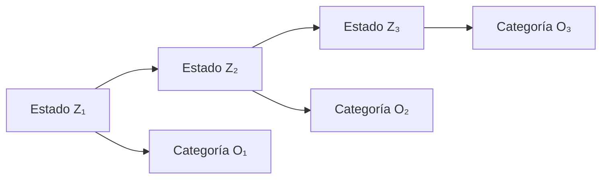

# Marco teórico

La notación se aplica al [modelo del catálogo sintético](modelo-y-diseno-experimental.md). Las referencias [3], [5] y [11] conservan la numeración del [estado del arte](estado-del-arte.md); sus vías gratuitas de lectura se documentan en el [registro de acceso](../referencias/acceso-a-fuentes.md).

## 1. Variables aleatorias y distribuciones

El índice t = 1,…,T identifica eventos consecutivos, no días. Z_t es el estado oculto y O_t la categoría de magnitud observada. Se distinguen las variables aleatorias Z_t y O_t de sus realizaciones z_t y o_t.

### Distribución categórica

Para una variable X con K categorías y vector de probabilidades p, se define:

$$
P(X=k)=p_k,\qquad p_k\geq 0,\qquad \sum_{k=0}^{K-1}p_k=1.
$$

En el modelo, Z_1 sigue una categórica con parámetros π; Z_(t+1), condicionada a Z_t=i, usa la fila i de A; O_t, condicionada a Z_t=i, usa la fila i de B. Son tres usos de la misma familia de distribuciones, con parámetros y funciones diferentes.

La distribución multinomial describe conteos de n extracciones independientes con el mismo vector p. Las categorías de una secuencia HMM pueden ser dependientes; por ello, sus conteos totales no se suponen automáticamente multinomiales.

### Distribuciones alternativas

| Variable observada | Familia pertinente | Relación con este estudio |
|---|---|---|
| Una categoría de magnitud por evento | Categórica | Emisión utilizada |
| Número de sismos en un intervalo | Poisson, si sus supuestos son adecuados | Emisiones de conteo como las de [3]; no se utilizan aquí |
| Una medición continua de magnitud | Densidad continua, por ejemplo normal | Emisiones gaussianas como las de [5]; no se utilizan aquí |

Una probabilidad categórica es una masa asignada a un símbolo; una densidad continua no es la probabilidad de un valor puntual. El tipo de observación determina la distribución que debe justificarse.

## 2. Cadena de Markov y homogeneidad

La cadena oculta satisface la propiedad de Markov de primer orden:

$$
P(Z_{t+1}=j\mid Z_1=z_1,\ldots,Z_t=i)
=P(Z_{t+1}=j\mid Z_t=i)=A_{ij}.
$$

La homogeneidad significa que A no cambia con t dentro de un escenario. No implica que la distribución de Z_t sea constante. Con vectores fila,

$$
q_1=\pi,\qquad q_{t+1}=q_tA,\qquad q_t=\pi A^{t-1}.
$$

Una distribución estacionaria ν satisface νA=ν y suma uno. No debe confundirse con π: la distribución inicial puede ser diferente. Esta distinción permite estudiar el efecto transitorio del escenario con inicio modificado.

En una cadena visible se observan los estados. En un HMM se observan símbolos asociados probabilísticamente a estados no observados [11]. El estado es una variable del modelo, no otra forma de nombrar la observación.

## 3. Componentes del HMM categórico

El modelo se expresa como λ=(S,V,A,B,π), con tres estados y tres símbolos. Se usan índices i,j,k ∈ {0,1,2}:

| Componente | Definición e interpretación |
|---|---|
| S={R,M,E} | Reposo Sísmico, Actividad Menor y Enjambre Sísmico: etiquetas latentes didácticas |
| V={v_0,v_1,v_2} | Magnitud baja (m<3), media (3≤m≤5) y alta (m>5) |
| π_i=P(Z_1=i) | Probabilidad de inicio en el estado i |
| A_ij=P(Z_(t+1)=j \| Z_t=i) | Probabilidad de transición; filas actuales y columnas siguientes |
| B_ik=P(O_t=v_k \| Z_t=i) | Probabilidad de emisión; filas de estados y columnas de símbolos |

Los elementos de π, A y B están en [0,1]. π y cada fila de ambas matrices suman uno. Los índices de las filas y columnas coinciden con el orden del [archivo de parámetros](../configuracion/modelo_base.json).

La independencia condicional de las emisiones se expresa como:

$$
P(O_t=v_k\mid Z_{1:T},O_1,\ldots,O_{t-1})
=P(O_t=v_k\mid Z_t)=B_{Z_t,k}.
$$

Condicionado el estado actual, las observaciones anteriores no añaden información sobre la emisión actual bajo este supuesto. Sin condicionar por los estados, las observaciones pueden ser dependientes y no tienen por qué formar una cadena de Markov de primer orden.

Las flechas entre estados representan A; las flechas de estado a observación representan B. π determina el primer estado. El diagrama describe dependencias del modelo, sin atribuir causalidad geofísica a sus etiquetas.

## 4. Probabilidad conjunta y verosimilitud

Sea o_t=v_(k_t). Para una trayectoria concreta z_(1:T),

$$
P(z_{1:T},o_{1:T}\mid\lambda)
=\pi_{z_1}B_{z_1,k_1}
\prod_{t=2}^{T} A_{z_{t-1},z_t}B_{z_t,k_t}.
$$

Si los estados no se conocen, se suman las probabilidades conjuntas de todas las trayectorias:

$$
L(\lambda;o_{1:T})=P(o_{1:T}\mid\lambda)
=\sum_{z_{1:T}\in S^T}P(z_{1:T},o_{1:T}\mid\lambda).
$$

Para parámetros fijados, esta expresión es la probabilidad de las observaciones. Al variar λ con las observaciones fijas, se interpreta como verosimilitud. Sumar trayectorias y elegir solo la más probable son operaciones diferentes.

## 5. Tres problemas clásicos

La distinción entre evaluación, decodificación y aprendizaje organiza los métodos del HMM [11].

| Problema | Entrada | Salida | Método |
|---|---|---|---|
| Evaluación | Observaciones y parámetros conocidos | Probabilidad o log-probabilidad de las observaciones | Forward |
| Decodificación | Observaciones y parámetros conocidos | Trayectoria de estados de máxima probabilidad posterior conjunta | Viterbi |
| Aprendizaje | Secuencias de entrenamiento y parámetros iniciales | Parámetros reestimados | Baum-Welch / EM |

### 5.1. Forward: sumar trayectorias

Se define α_t(i)=P(O_(1:t)=o_(1:t), Z_t=i \| λ). Sus recurrencias son:

$$
\alpha_1(i)=\pi_iB_{i,k_1},
$$

$$
\alpha_t(j)=B_{j,k_t}\sum_{i=0}^{2}\alpha_{t-1}(i)A_{ij},
\qquad t=2,\ldots,T,
$$

$$
P(o_{1:T}\mid\lambda)=\sum_{i=0}^{2}\alpha_T(i).
$$

La recurrencia reúne los prefijos que terminan en cada estado. Forward resuelve la evaluación sin enumerar las 3^T trayectorias y no produce por sí mismo una trayectoria decodificada.

### 5.2. Viterbi: maximizar una trayectoria

Se busca:

$$
\widehat z_{1:T}=\arg\max_{z_{1:T}}P(z_{1:T}\mid o_{1:T},\lambda).
$$

Cuando P(o_(1:T) \| λ)>0, el denominador del posterior es común a todas las trayectorias; se puede maximizar la probabilidad conjunta. En logaritmos:

$$
d_1(i)=\log\pi_i+\log B_{i,k_1},
$$

$$
d_t(j)=\log B_{j,k_t}+
\max_i[d_{t-1}(i)+\log A_{ij}],
$$

$$
\psi_t(j)=\arg\max_i[d_{t-1}(i)+\log A_{ij}].
$$

Se toma ẑ_T=argmax_i d_T(i) y se reconstruye ẑ_t=ψ_(t+1)(ẑ_(t+1)) hacia atrás. Un empate se resolverá con una regla determinista.

El valor max_i d_T(i) es el logaritmo de la probabilidad conjunta de la mejor trayectoria, no el logaritmo de la probabilidad total de las observaciones. La trayectoria más probable tampoco tiene por qué maximizar la exactitud por evento [11].

### 5.3. Baum-Welch: reestimar parámetros

El aprendizaje alterna expectativas sobre estados y transiciones con actualización de parámetros. Para una secuencia se definen:

$$
\gamma_t(i)=P(Z_t=i\mid o_{1:T},\lambda),
\qquad
\xi_t(i,j)=P(Z_t=i,Z_{t+1}=j\mid o_{1:T},\lambda).
$$

Forward y Backward permiten calcularlas. Con β_T(i)=1 y

$$
\beta_t(i)=\sum_j A_{ij}B_{j,k_{t+1}}\beta_{t+1}(j),
$$

se obtiene, en aritmética exacta sin escalamiento,

$$
\gamma_t(i)=\frac{\alpha_t(i)\beta_t(i)}{L},
\qquad
\xi_t(i,j)=\frac{\alpha_t(i)A_{ij}B_{j,k_{t+1}}\beta_{t+1}(j)}{L}.
$$

Las actualizaciones categóricas, cuando sus denominadores son positivos, son:

$$
\pi_i^{\mathrm{nuevo}}=\gamma_1(i),\qquad
A_{ij}^{\mathrm{nuevo}}=
\frac{\sum_{t=1}^{T-1}\xi_t(i,j)}{\sum_{t=1}^{T-1}\gamma_t(i)},
$$

$$
B_{ik}^{\mathrm{nuevo}}=
\frac{\sum_{t=1}^{T}\gamma_t(i)\,\mathbf{1}\{o_t=v_k\}}
{\sum_{t=1}^{T}\gamma_t(i)}.
$$

Son proporciones de conteos esperados, no conteos de una única trayectoria de Viterbi. La iteración no garantiza el máximo global. En este estudio A, B y π son conocidos y fijados: Baum-Welch se expone como fundamento, sin afirmar que se entrenará el modelo.

## 6. Estabilidad numérica

En secuencias largas se evitarán productos directos que puedan redondearse a cero. Para Forward se puede normalizar en cada paso:

$$
u_1(i)=\pi_i B_{i,k_1},\qquad
c_1=\sum_i u_1(i),\qquad \widehat\alpha_1(i)=u_1(i)/c_1.
$$

Para t≥2,

$$
u_t(j)=B_{j,k_t}\sum_i\widehat\alpha_{t-1}(i)A_{ij},\quad
c_t=\sum_j u_t(j),\quad \widehat\alpha_t(j)=u_t(j)/c_t.
$$

Con esta definición de los factores c_t,

$$
\log L=\sum_{t=1}^{T}\log c_t.
$$

Si c_t=0, las observaciones tienen probabilidad nula bajo el modelo y no procede dividir por ese factor. En Viterbi, log(0)=−∞ representa una transición o emisión imposible. Estas convenciones forman parte de la validación de la futura implementación.

## 7. Ejemplo analítico con las matrices base

Los valores de esta sección se deducen de los [parámetros base](../configuracion/modelo_base.json). Se comprobaron mediante aritmética racional y enumeración de casos pequeños; no son resultados de simulación.

Para una primera observación de magnitud alta, los pesos de los estados son:

| Estado | π_i | B_i,alta | Producto |
|---|---:|---:|---:|
| R | 0.80 | 0.03 | 0.024 |
| M | 0.15 | 0.10 | 0.015 |
| E | 0.05 | 0.40 | 0.020 |

Por tanto, P(O_1=alta)=0.059 y

$$
P(Z_1\mid O_1=\mathrm{alta})
\approx (0.406780,\ 0.254237,\ 0.338983).
$$

E es el estado que emite magnitudes altas con mayor probabilidad, pero R tiene el mayor posterior inicial debido a π. La emisión P(alta \| E) y el posterior P(E \| alta) no son intercambiables.

Para dos observaciones altas, la suma de las nueve trayectorias posibles da P(alta,alta)=0.008733. La trayectoria más probable es (E,E), cuya probabilidad conjunta es 0.05×0.40×0.60×0.40=0.0048. Su probabilidad posterior es 0.0048/0.008733≈0.549639. Una segunda observación puede cambiar la estimación del primer estado al decodificar la secuencia completa.

## 8. Persistencia y duración de los estados

En el HMM homogéneo, la duración D_i de una visita completa al estado i es geométrica con soporte {1,2,…}, siempre que A_ii<1:

$$
P(D_i=d)=A_{ii}^{d-1}(1-A_{ii}),\qquad
E[D_i]=\frac{1}{1-A_{ii}}.
$$

Para las diagonales 0.85, 0.50 y 0.60 del caso base, las medias teóricas son 6.666667, 2 y 2.5 eventos, respectivamente. Son consecuencias analíticas de las matrices, no duraciones físicas medidas. Las visitas cortadas por el inicio o el final del catálogo deben tratarse como observaciones censuradas al analizar longitudes de rachas.

En el escenario A'=0.5A+0.5I, la probabilidad de salir de cada estado se reduce a la mitad; por la expresión anterior, su duración media teórica se duplica. Ese resultado no predice cómo cambiará la exactitud de Viterbi: deberá evaluarse mediante simulación.

## 9. Comparación sin utilizar la secuencia observada completa

El decodificador de referencia empleará el prior marginal q_t=πA^(t−1) y solo la observación del evento t:

$$
\widetilde z_t=\arg\max_i q_t(i)B_{i,k_t}.
$$

Usa los mismos parámetros conocidos que Viterbi, pero no utiliza observaciones de otros eventos. No accede a los estados generadores para decidir. Es una comparación de reglas de inferencia; no implica que ambos métodos optimicen el mismo criterio.

## 10. Relación con la evaluación experimental

La exactitud será la fracción de coincidencias entre estados generados y decodificados. Se puede expresar cada coincidencia con un indicador de valores cero o uno; ello no convierte las coincidencias de una secuencia en ensayos Bernoulli independientes.

Los promedios y la incertidumbre se calcularán sobre réplicas independientes del catálogo completo. La recuperación de estados se evaluará porque la simulación conserva la trayectoria generadora; esto no proporciona etiquetas geofísicas reales. Las conclusiones sobre desempeño y sensibilidad quedan pendientes de los experimentos.
